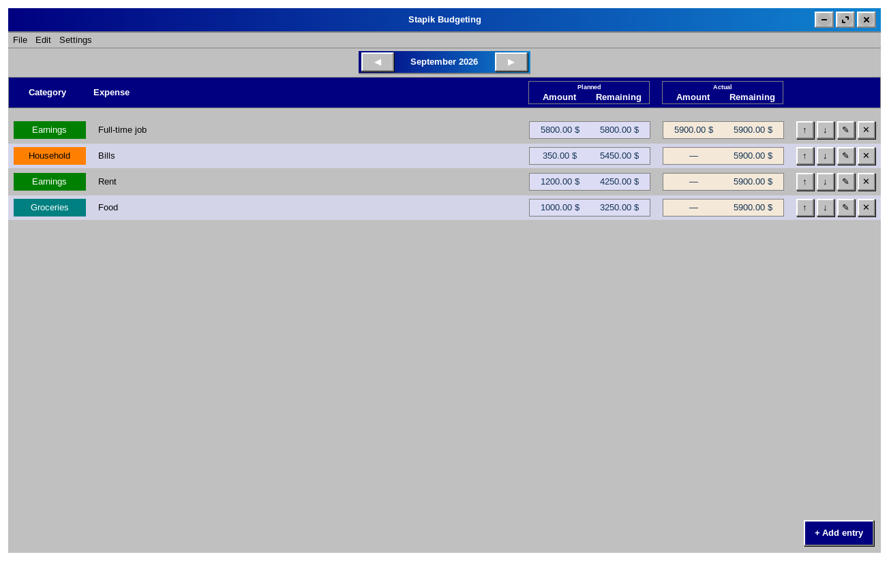
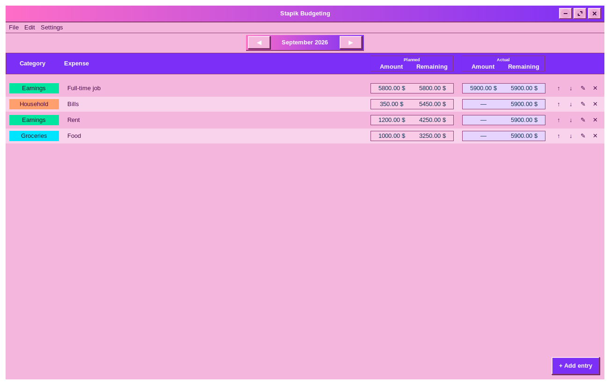
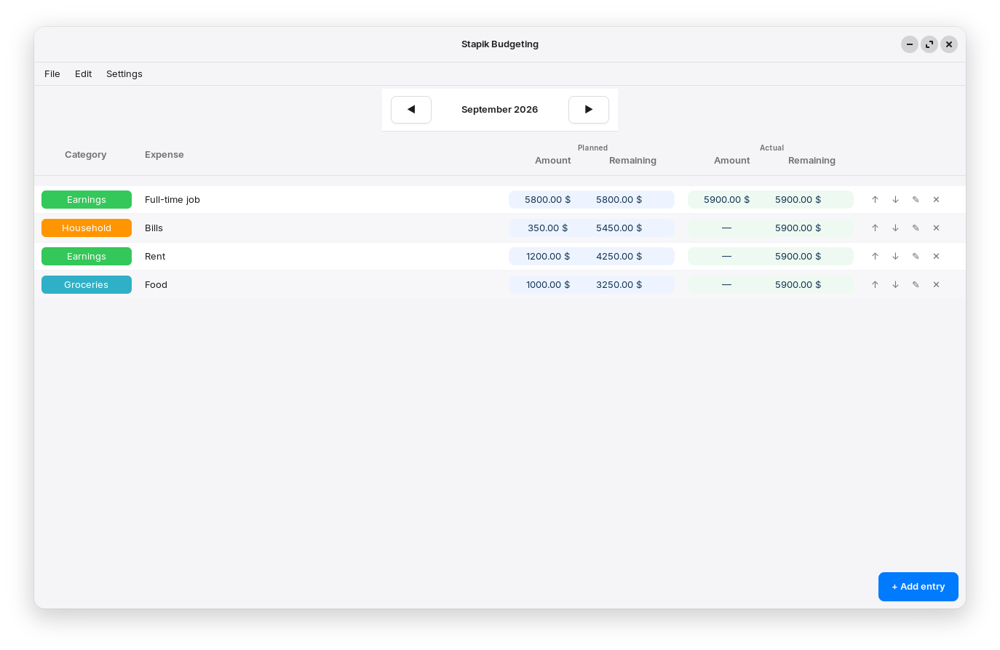

# Stapik Budgeting

A desktop budgeting application for Linux, written in C++20 using GTK4/gtkmm. Track your income and expenses in a simple monthly view, with customizable categories, currencies, languages and themes.



## Features

* **Monthly view** — organize your budget by month and keep your financial entries in one place.
* **Income and expenses** — track planned and actual amounts and see the remaining totals for the current month.
* **Custom categories** — own categories, each with a customizable color.
* **Multiple currencies** — the budget has its own currency, with localized currency names, and amounts are stored exactly as whole minor units.
* **Cloud sync** — save and load your budget via an external API, compatible with a self-hosted server, with automatic conflict resolution based on timestamps.
* **Multilingual UI** — Polish, English and German interface with instant switching.
* **Auto-save** — budget data is saved locally after every change.
* **Five themes** — Classic, Modern, Classic Pink, Dark and Neoclassic, switchable live from the settings window.
* **Retro aesthetic** — the Classic theme features the original old-school look with raised controls, blue accents and grey cells.

## Dependencies

* `gtkmm-4.0`
* `libcurl`
* [`stapik-common`](https://github.com/Stapik-Group/stapik-common) 1.6.0 (fetched automatically via CMake FetchContent)
* `libsodium` and `zlib`, required by `stapik-common`
* `libsecret` (optional, keeps the cloud API key in the system keyring)
* `nlohmann/json` (fetched automatically via CMake FetchContent, transitively provided by `stapik-common`)

On Ubuntu/Debian:

```bash
sudo apt install libgtkmm-4.0-dev libcurl4-openssl-dev libsodium-dev zlib1g-dev libsecret-1-dev libx11-dev
```

Building a `.deb` package additionally requires `dpkg-dev` (used to auto-detect runtime dependencies):

```bash
sudo apt install dpkg-dev
```

## Building

```bash
git clone https://github.com/Stapik-Group/stapik-budgeting
cd stapik-budgeting
cmake -B cmake-build-release -DCMAKE_BUILD_TYPE=Release
cmake --build cmake-build-release
```

## Installation

### Option 1 — Download prebuilt `.deb` (recommended)

Download the latest `.deb` package from the [Releases page](https://github.com/Stapik-Group/stapik-budgeting/releases), then install it:

```bash
sudo dpkg -i stapikbudgeting_*.deb
sudo apt install -f   # resolves any missing runtime dependencies
```

### Option 2 — Build `.deb` from source

If you'd rather build the package yourself:

```bash
cd cmake-build-release
cpack -G DEB
sudo dpkg -i stapikbudgeting_*.deb
sudo apt install -f
```

Either option installs the app to `/opt/stapikbudgeting/`, with a launcher at `/usr/bin/stapikbudgeting`, and it appears in the desktop environment's application menu.

### Option 3 — Per-user install (no sudo required)

```bash
cmake -B cmake-build-user -DCMAKE_BUILD_TYPE=Release \
    -DCMAKE_INSTALL_PREFIX="$HOME/.local/opt/stapikbudgeting" \
    -DSTAPIK_APP_SYSTEM_PREFIX="$HOME/.local"
cmake --build cmake-build-user
cmake --install cmake-build-user
```

Installs to `~/.local/opt/stapikbudgeting/`, with a launcher at `~/.local/bin/stapikbudgeting`. Make sure `~/.local/bin` is in your `PATH`.

## Uninstalling

### If installed via `.deb`

```bash
sudo dpkg -r stapikbudgeting
```

### If installed per-user

```bash
rm -rf ~/.local/opt/stapikbudgeting
rm ~/.local/bin/stapikbudgeting
rm ~/.local/share/applications/pl.stapik.budgeting.desktop
rm ~/.local/share/icons/hicolor/256x256/apps/pl.stapik.budgeting.png
```

Uninstalling the application does not remove your budget data, cloud configuration, language preference or theme stored in `~/.local/share/stapikbudgeting/`.

## Cloud Sync

The app supports synchronization via [Stapik Cloud](https://github.com/Stapik-Group/stapik-cloud) 1.2.0 or newer. Go to **File → Connect**, enter the server URL and API key, and optionally an end-to-end encryption passphrase. If a connection is already configured, the app reconnects automatically on startup. **File → Disconnect** forgets the connection, the API key and the passphrase; the local budget is not touched.

Synchronization runs in the background, so the window never waits for the network. Every change is saved locally first and sent to the cloud shortly afterwards. When the server is unreachable, the change stays in the local file and is retried with growing delays. You can also trigger a synchronization manually from **File → Sync**, and pending changes are sent when the window is closed.

On connecting, the app compares the local budget and the cloud copy by their `lastUpdate` timestamps and keeps the newer one, replacing the other **as a whole document**. There is no field-level or entry-level merging. If another device saved in the meantime, the cloud rejects the write, the app fetches the server's copy and either accepts it or retries once, depending on which one is newer.

With an end-to-end encryption passphrase the server only sees encrypted data. Without the passphrase the data cannot be recovered, so enter the same one on every device. The app warns when the API key is about to expire and when the cloud refuses a sync for a reason that retrying cannot fix (a rejected key, a wrong passphrase, a document that is too large or unreadable).

Amounts are stored as integer minor units, so the cloud copy written by this version cannot be read by version 1.0.0. Update every device that shares a budget.

**Caution for multi-device use:** because conflict resolution operates on the whole document, editing the budget offline on two different machines before either one reconnects can cause one set of changes to be discarded. Stapik Cloud keeps a version history of every write, so a discarded document is not permanently lost, but the application does not currently expose a way to browse or restore previous versions. If you use the app on multiple devices, synchronize regularly to avoid overwriting your own changes.

The app communicates with the Stapik Cloud `/documents/{slotKey}` endpoint using an `x-api-key` header.

## Data Storage

Budget data is stored locally at:

```text
~/.local/share/stapikbudgeting/budget.json
```

The document contains the budget categories, periods, currency code and `lastUpdate` timestamp used for cloud synchronization. Amounts are whole minor units of the budget currency (for example grosze), and changing the currency re-expresses the same figures in the new currency without converting them.

Every save is written atomically, so a crash can never leave a half-written file. The three previous versions are kept next to it as `budget.json.bak`, `budget.json.bak.2` and `budget.json.bak.3`. A file that cannot be read is never overwritten: it is moved aside as `budget.json.corrupt-<timestamp>` and the application starts with an empty budget.

Files written by version 1.0.0 are upgraded automatically on the first start, with the amounts converted to minor units, and the original stays available as `budget.json.bak`. The data directory follows `XDG_DATA_HOME` and the `--data-dir` and `--portable` command line options.

Other application data is stored at:

```text
~/.local/share/stapikbudgeting/config.json
~/.local/share/stapikbudgeting/settings.json
```

Cloud configuration and the preferences (language, theme, font) are kept separately from the synchronized budget document. Preferences from earlier versions (`locale.txt`, `theme.txt`) are imported on the first start. The currency preference stored in `currency.txt` by version 1.0.0 is used as the currency of a newly created budget.

## Settings

**Settings → Settings…** opens one window with the language, the theme, the font and the currency of the budget. Every change is applied and saved at once. The Edit menu shows what Undo and Redo will do, for example "Undo Delete entry", and the usual shortcuts work: `Ctrl+Z`, `Ctrl+Shift+Z` and `Ctrl+Q`.

## Themes

Choose a theme in the settings window:

* **Classic** — the original retro look with raised controls, blue accents and grey cells.
* **Modern** — a clean, flat and minimal appearance.
* **Classic Pink** — the retro aesthetic with a pink color palette.
* **Dark** and **Neoclassic** — themes shared by all Stapik applications.

The theme applies instantly and is remembered between launches.




## TODO

* [x] Monthly budget view
* [x] Income and expense tracking
* [x] Custom categories with colors
* [x] Multiple currencies
* [x] Multilingual UI
* [x] Cloud sync with conflict resolution
* [x] Auto-save
* [x] `.deb` package for easier distribution
* [x] Multiple themes (Classic / Modern / Classic Pink / Dark / Neoclassic)
* [ ] Import from an existing spreadsheet (CSV/XLSX)
* [ ] Budget statistics and charts
* [ ] Flatpak package
